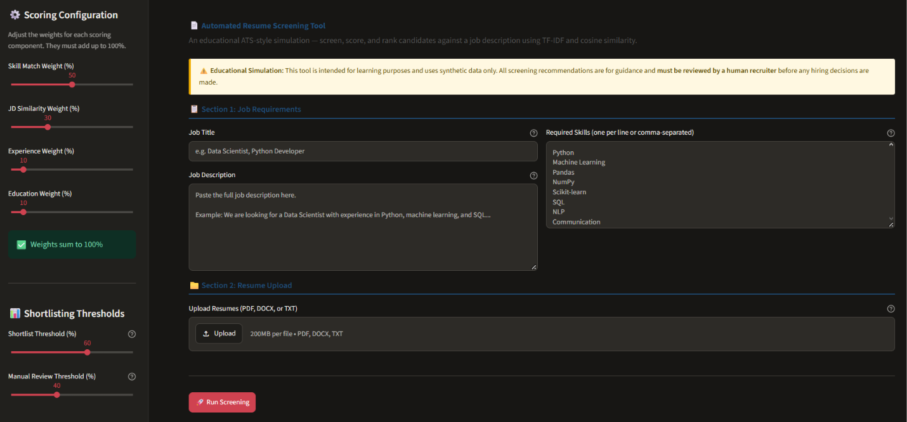
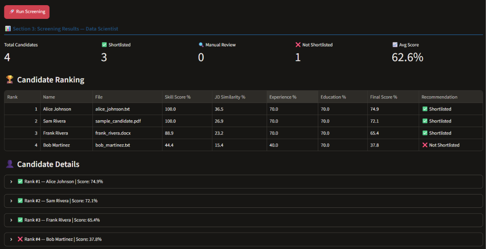
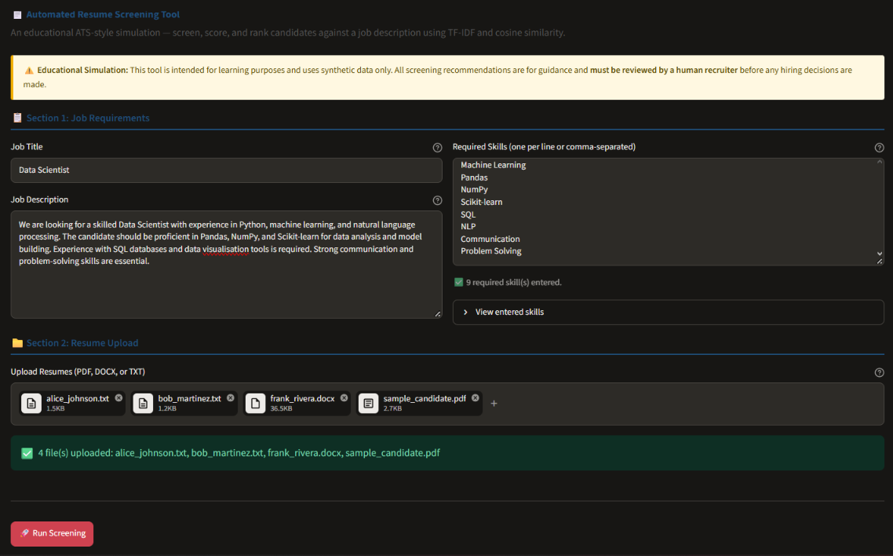
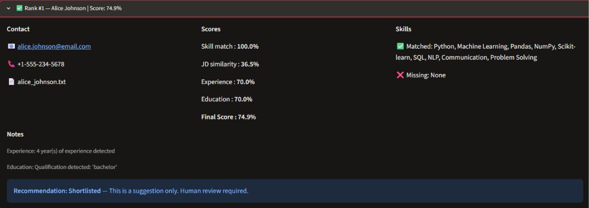
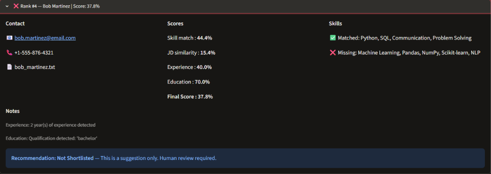
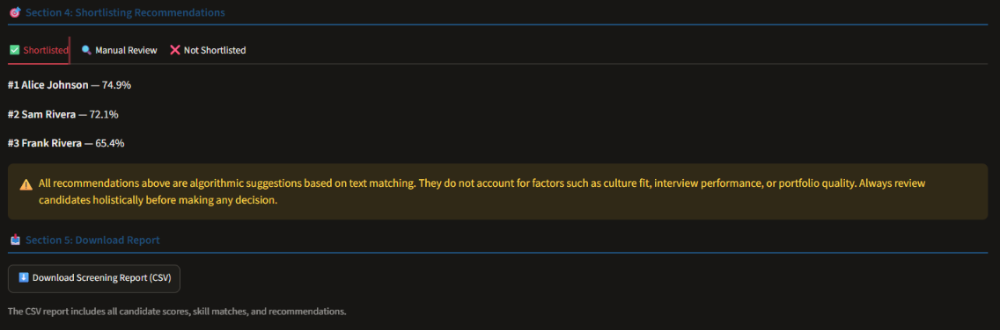

# 📄 Automated Resume Screening Tool

> **Educational Project** — An ATS-style simulation built in Python as a practical portfolio project.
> All candidate data is entirely synthetic (fictional). This tool is for learning purposes only.

---

## 📌 Project Overview

The **Automated Resume Screening Tool** is a Python application that simulates how modern
Applicant Tracking Systems (ATS) work. It processes multiple candidate resumes, extracts key
information, compares resumes against a job description using NLP techniques (TF-IDF + cosine
similarity), calculates match scores, ranks candidates, and generates structured screening reports.

This project demonstrates real-world skills in:
- Text extraction (PDF, DOCX, TXT)
- Natural Language Processing (TF-IDF, Cosine Similarity)
- Data analysis (Pandas, NumPy)
- Modular Python programming
- Interactive web dashboards (Streamlit)
- Automated testing (unittest)

---

## ✨ Features

| # | Feature | Status |
|---|---------|--------|
| 1 | PDF, DOCX, and TXT resume text extraction | ✅ |
| 2 | Candidate information extraction (name, email, phone) | ✅ |
| 3 | Text cleaning and normalisation | ✅ |
| 4 | Technical and soft skill extraction | ✅ |
| 5 | Required skill matching and gap analysis | ✅ |
| 6 | TF-IDF vectorisation + cosine similarity scoring | ✅ |
| 7 | Configurable weighted scoring system | ✅ |
| 8 | Fair "Not Assessed" handling for missing information | ✅ |
| 9 | Candidate ranking and shortlisting | ✅ |
| 10 | Timestamped CSV report generation | ✅ |
| 11 | Interactive Streamlit dashboard | ✅ |
| 12 | Automated test suite (31 tests, unittest) | ✅ |

---

## 🛠️ Technology Stack

| Category | Technology | Purpose |
|----------|-----------|---------|
| Core Language | Python 3.10+ | Main programming language |
| Data Processing | Pandas | Candidate data management and CSV export |
| Numerical Operations | NumPy | Array operations (used by scikit-learn) |
| PDF Extraction | pdfplumber | Extract text from PDF resume files |
| DOCX Extraction | python-docx | Extract text from Word resume files |
| Text Cleaning | Regex (re) | Information extraction and normalisation |
| NLP / ML | Scikit-learn | TF-IDF vectorisation and cosine similarity |
| Web Dashboard | Streamlit | Interactive visual dashboard |
| Report Export | CSV | Structured output file generation |

---

## 📁 Folder Structure

```
Automated-Resume-Screening-Tool/
│
├── resumes/                     # Synthetic candidate resume files
│   ├── alice_johnson.txt        # Strong candidate (TXT)
│   ├── bob_martinez.txt         # Moderate candidate (TXT)
│   ├── frank_rivera.docx        # DOCX format example
│   └── sample_candidate.pdf    # PDF format example
│
├── data/                        # Job descriptions and input data
│   └── job_description.json
│
├── src/                         # Python source modules
│   ├── __init__.py
│   ├── resume_parser.py         # PDF/DOCX/TXT text extraction
│   ├── text_cleaner.py          # Text normalisation
│   ├── skill_extractor.py       # Skill detection and matching
│   ├── similarity.py            # TF-IDF and cosine similarity
│   ├── score_calculator.py      # Weighted scoring system
│   ├── candidate_ranker.py      # Ranking and recommendations
│   ├── report_generator.py      # CSV report generation
│   └── screening_engine.py      # Central orchestration module
│
├── tests/                       # Automated test suite
│   ├── __init__.py
│   └── test_project.py          # Unified 31-test suite (unittest)
│
├── outputs/                     # Generated screening reports (CSV)
│   └── .gitkeep
│
├── app.py                       # Streamlit dashboard
├── main.py                      # Command-line interface
├── requirements.txt             # Python dependencies
├── .gitignore                   # Git ignore rules
└── README.md                    # This file
```

---

## 🏗️ Project Architecture

```
INPUT LAYER
│   Resumes (PDF / DOCX / TXT)
│   Job Description (text)
│   Required Skills (list)
│
▼
PROCESSING LAYER
│   resume_parser.py    — Text extraction + candidate info
│   text_cleaner.py     — Normalisation and cleaning
│   skill_extractor.py  — Skill detection and matching
│   similarity.py       — TF-IDF + cosine similarity
│   score_calculator.py — Weighted scoring (with Not Assessed logic)
│   candidate_ranker.py — Sorting and recommendations
│   screening_engine.py — Orchestration (coordinates all modules)
│
▼
OUTPUT LAYER
    Individual candidate scores
    Matched / missing skills
    Shortlisting recommendations
    Ranked candidate list
    CSV reports (outputs/)
    Streamlit dashboard (app.py)
```

---

## 🚀 Installation

### 1. Clone the Repository
```bash
git clone https://github.com/yourusername/Automated-Resume-Screening-Tool.git
cd Automated-Resume-Screening-Tool
```

### 2. Create a Virtual Environment

**Windows:**
```bash
python -m venv venv
venv\Scripts\activate
```

**macOS:**
```bash
python3 -m venv venv
source venv/bin/activate
```

> Once activated, your terminal prompt shows `(venv)` — this confirms the
> virtual environment is active. Run `deactivate` to exit it.

> **Windows PowerShell note:** If activation fails with a script execution error,
> run this once in PowerShell as Administrator:
> ```powershell
> Set-ExecutionPolicy -ExecutionPolicy RemoteSigned -Scope CurrentUser
> ```

### 3. Install Dependencies
```bash
pip install -r requirements.txt
```

**What each library does:**

| Library | Purpose |
|---------|---------|
| `pandas` | Structures candidate data and exports CSV reports |
| `numpy` | Numerical operations used internally by scikit-learn |
| `pdfplumber` | Extracts text from PDF resume files |
| `python-docx` | Extracts text from Word (.docx) resume files |
| `scikit-learn` | TF-IDF vectorisation and cosine similarity |
| `streamlit` | Interactive web dashboard |

> `re` (regular expressions) is a Python built-in — no installation needed.

### 4. Verify Installation
```bash
pip list
```
Confirm that `pandas`, `numpy`, `pdfplumber`, `python-docx`, `scikit-learn`, and `streamlit` appear.

---

## ▶️ Running the Application

### Option A — Command-Line Interface
```bash
python main.py
```
Follow the prompts. Press **Enter** at each step to use the built-in sample data.

### Option B — Streamlit Dashboard
```bash
streamlit run app.py
```
Opens an interactive browser dashboard at `http://localhost:8501`.

Upload resumes, adjust scoring weights in the sidebar, and download the results as CSV.

---

## 🧪 Running the Automated Tests

The full test suite is in `tests/test_project.py` and covers all 8 modules,
Not Assessed scoring, PDF/DOCX/TXT extraction, CSV generation, and the full pipeline.

```bash
python -m unittest discover -s tests -v
```

**Expected result:**
```
...
----------------------------------------------------------------------
Ran 31 tests in X.XXXs

OK
```

You can also run the test file directly:
```bash
python tests/test_project.py
```

---

## ⚙️ Scoring System

The final candidate score is a weighted combination of four components:

| Component | Default Weight | Score Type | Description |
|-----------|---------------|-----------|-------------|
| Skill Match | 50% | `float` | % of required skills found in resume |
| JD Similarity | 30% | `float` | TF-IDF cosine similarity to job description |
| Experience | 10% | `float` \| **Not Assessed** | Estimated from year references in resume text |
| Education | 10% | `float` \| **Not Assessed** | Detected from degree-level keywords |

**Standard formula (all components available):**
```
Final Score = (Skill Score × 0.50) + (JD Similarity × 0.30)
            + (Experience Score × 0.10) + (Education Score × 0.10)
```

Weights are fully configurable in the Streamlit dashboard sidebar.

---

### 🔍 "Not Assessed" Scoring — Fair Handling of Missing Information

Experience and education scores are estimated using **keyword signals** in the
resume text (e.g. "3 years experience", "Bachelor of Science"). When no such
signals are found, the component is marked **Not Assessed** — it is *not*
assigned a score of zero.

**Why this matters:** A score of zero would unfairly penalise candidates whose
resumes simply do not contain the expected keywords. "Not Assessed" means
*no information was available*, not *no qualification exists*.

**What happens when a component is Not Assessed:**
- Its weight is **excluded** from the calculation.
- The remaining weights are **renormalised proportionally** so they still sum to 100%.
- The final score is computed only from the components that *could* be assessed.
- The CSV `Score Basis` column and dashboard notes explain which components were excluded.

**Example — both experience and education unavailable:**

| Component | Score | Default Weight | Renormalised Weight |
|-----------|-------|---------------|---------------------|
| Skill Match | 80% | 50% | 62.5% (= 50 ÷ 80) |
| JD Similarity | 90% | 30% | 37.5% (= 30 ÷ 80) |
| Experience | *Not Assessed* | 10% | — excluded — |
| Education | *Not Assessed* | 10% | — excluded — |

```
Final Score = (80 × 0.625) + (90 × 0.375) = 50.0 + 33.75 = 83.75%
```

> ⚠️ **This tool never invents scores.** If experience or education cannot be
> reliably detected, it will always say so explicitly.

---

**Shortlisting Thresholds (configurable):**
- Score ≥ 60% → ✅ Shortlisted
- Score 40–59% → 🔍 Manual Review
- Score < 40% → ❌ Not Shortlisted

---

## 📊 Sample Output

```
==================================================
   AUTOMATED RESUME SCREENING TOOL
==================================================

[1/6] Loading resumes...
  Found 4 resume(s) in 'resumes'

[2/6] Cleaning text...
[3/6] Calculating TF-IDF similarity scores...
[4/6] Extracting and matching skills...
[5/6] Calculating final scores...
[6/6] Ranking candidates...

RANK   NAME                  SCORE   RECOMMENDATION
------------------------------------------------------
1      Alice Johnson         73.5%   Shortlisted
2      Sam Rivera            65.2%   Shortlisted
3      Bob Martinez          37.6%   Not Shortlisted
```

---

## 📂 CSV Report Columns

Generated automatically in `outputs/` with a timestamp:

| Column | Type | Description |
|--------|------|-------------|
| Rank | int | Candidate rank (1 = best match) |
| Name | str | Extracted candidate name |
| Email | str | Extracted email address |
| Phone | str | Extracted phone number |
| Extracted Skills | str | All skills found in resume |
| Matched Skills | str | Required skills found in resume |
| Missing Skills | str | Required skills not found |
| Skill Score (%) | float | Skill match percentage |
| Similarity Score (%) | float | TF-IDF cosine similarity |
| Experience Score (%) | float \| "Not Assessed" | Estimated experience score |
| Education Score (%) | float \| "Not Assessed" | Detected education level score |
| Final Score (%) | float | Weighted final score (renormalised if any component is Not Assessed) |
| Score Basis | str | Explains which components contributed and which were excluded |
| Recommendation | str | Shortlisted / Manual Review / Not Shortlisted |

---

## ⚠️ Limitations

- Name extraction uses a simple heuristic (first title-cased line) and may not work for all resume layouts.
- Experience scoring is estimated from keyword signals (e.g. "3 years experience"), not parsed work history. If no signals are found, the component is marked **Not Assessed** and excluded from the final score.
- Education scoring detects degree-level keywords (e.g. "Bachelor", "Master"). If no keywords are found, it is marked **Not Assessed** and excluded from the final score.
- TF-IDF is a bag-of-words model — it does not understand semantic meaning.
- Skill matching requires skills to be explicitly stated in the resume text.
- PDF files with scanned images (non-searchable) cannot be parsed.

---

## 🔮 Future Enhancements

- [ ] Add support for scanned PDFs using OCR (pytesseract).
- [ ] Integrate spaCy for improved NLP and named entity recognition.
- [ ] Add semantic similarity using sentence transformers.
- [ ] Parse structured work history (company, dates, role).
- [ ] Support for multi-language resumes.
- [ ] Add charts and visualisations to the dashboard.
- [ ] Database integration for persistent screening history.

---

## 🚦 Development Status

| Phase | Description | Status |
|-------|-------------|--------|
| Phase 1 | Environment Setup | ✅ Complete |
| Phase 2 | Project Folder Structure | ✅ Complete |
| Phase 3 | Sample Resume Creation | ✅ Complete |
| Phase 4 | Job Description Creation | ✅ Complete |
| Phase 5 | Resume Text Extraction | ✅ Complete |
| Phase 6 | Text Cleaning | ✅ Complete |
| Phase 7 | Skill Matching | ✅ Complete |
| Phase 8 | Resume Scoring | ✅ Complete |
| Phase 9 | Ranking & Shortlisting | ✅ Complete |
| Phase 10 | Report Generation | ✅ Complete |
| Phase 11 | GitHub Upload | 🔄 Planned |

---

## 🪟 Windows & macOS Quick Reference

| Task | Windows | macOS |
|------|---------|-------|
| Check Python version | `python --version` | `python3 --version` |
| Create virtual environment | `python -m venv venv` | `python3 -m venv venv` |
| Activate virtual environment | `venv\Scripts\activate` | `source venv/bin/activate` |
| Deactivate | `deactivate` | `deactivate` |
| Install dependencies | `pip install -r requirements.txt` | `pip install -r requirements.txt` |
| Run CLI | `python main.py` | `python3 main.py` |
| Run dashboard | `streamlit run app.py` | `streamlit run app.py` |
| Run tests | `python -m unittest discover -s tests -v` | `python3 -m unittest discover -s tests -v` |

---

## 🖼️ Screenshots

### 1. Dashboard Overview



### 2. Resume Screening Results



### 3. Upload Resumes



### 4. Top Candidate



### 5. Rejected Candidate



### 6. Conclusion and Report



---

## ⚠️ Disclaimer

This project uses **entirely synthetic (fictional) candidate data** for testing purposes.
It is an **educational simulation** and does **not** process or store any real personal
information. All screening recommendations are illustrative only and must always be
reviewed by a human recruiter before any decisions are made.

This tool is **not** a commercial ATS and should **not** be used for real hiring processes
without significant additional development, testing, legal review, and human oversight.

---

## 📄 License

This project is developed for educational purposes as part of a Python course.

---

*Built with ❤️ as a Python course project — Automated Resume Screening Tool*
